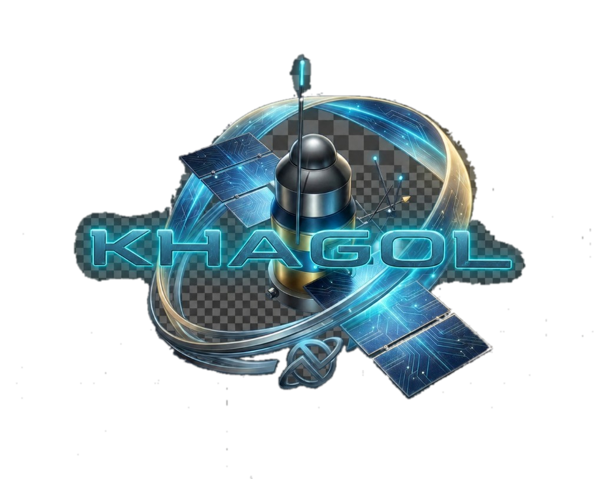

# 🛰️ KHAGOL // SPACE AGENCY : THE MISSION ARCHITECT
### Human Space Exploration & Systems Engineering Simulation Platform

[](https://fastapi.tiangolo.com)
[](https://threejs.org)
[](https://python.org)
[](https://www.aiaa.org)
[](https://standards.nasa.gov)
[](LICENSE)

<div align="center">
  
  <p><em>"The Universe is Your Next Mission."</em></p>
</div>

---

## 🌌 Overview

**KHAGOL // SPACE AGENCY** is an aerospace strategy, systems engineering, and planetary exploration simulation platform. Designed under authentic NASA Jet Propulsion Laboratory (JPL) CDF and AIAA S-120 standards, players assume the role of an Agency Director or specialist engineer to architect spacecraft, validate mass and power margins, manage communication links, execute multi-stage launches, and explore worlds across the Solar System.

The platform provides multiple interconnected operational environments:
1. **Cinematic Public Portal (`/`)**: A 3D WebGL experience featuring procedural Earth, a 30-body Solar System map, an interactive Spacecraft CAD assembly, Pad 39A countdown & liftoff physics, and real-time Mission Control telemetry.
2. **Flight Engineering Workstation (`/app`)**: The flagship 16-module systems engineering CAD suite compliant with AIAA S-120 margin policies.
3. **Mars Exploration Dual-Game (`/mars`)**: Standalone planetary module featuring the **Satellite Mission Designer** and the **Mars Rover Explorer** with Deep Space RF communications.
4. **Titan Surface EVA (`/static/titan.html`)**: Survival expedition on Saturn's moon Titan featuring sub-surface methane navigation and radar telemetry.
5. **4-Player Cooperative Multiplayer**: Synchronized sessions across 4 specialist stations (Flight Systems, Science Payload, Propulsion/Trajectory, Flight Operations) with mandatory Flight Readiness Review (FRR) consensus voting.

---

## 🛠️ System Architecture

```
                                  +---------------------------------------+
                                  |     KHAGOL PUBLIC PORTAL (/)          |
                                  |  Three.js WebGL Earth & Solar System  |
                                  +-------------------+-------------------+
                                                      |
                 +------------------------------------+------------------------------------+
                 |                                    |                                    |
+----------------v------------------+  +--------------v--------------------+  +------------v------------------+
|  ENGINEERING WORKSTATION (/app)   |  |   MARS DUAL-GAME PLATFORM (/mars) |  |   TITAN SURFACE EVA (/titan)  |
|  - 3D Spacecraft CAD Workbench    |  |  - Game 1: Satellite Mission Des. |  |  - Cryogenic Survival Sim     |
|  - AIAA S-120 Mass & Power Engine |  |  - Game 2: Surface Rover Explorer |  |  - Methane Lake Navigation    |
|  - Launch Vehicle Pad Simulator   |  |  - Deep Space RF Communications   |  |  - Radar Ping Telemetry       |
|  - NASA Open MCT Telemetry        |  |  - 4-Player Collaborative Exped.  |  +-------------------------------+
+----------------+------------------+  +--------------+--------------------+
                 |                                    |
                 +-----------------+------------------+
                                   |
                  +----------------v-------------------+
                  |        FASTAPI BACKEND CORE        |
                  |  - /api/v1/simulation/validate     |
                  |  - /api/v1/simulation/execute      |
                  |  - /api/v1/solar-system/bodies     |
                  |  - /api/v1/missions/catalogue      |
                  |  - /api/v1/agency/profile          |
                  |  - /api/v1/multiplayer/sessions    |
                  |  - /api/v1/mars/multiplayer/room   |
                  +------------------------------------+
```

---

## 📐 Aerospace Standards & Engineering Formulations

### 1. Mass Growth Allowances (AIAA S-120)
All spacecraft structural components are evaluated using maturity-dependent Mass Growth Allowances (MGA):
$$\text{Margin}_{\text{dry}} = \frac{M_{\text{limit}} - \sum (m_i \cdot [1 + \text{MGA}_i])}{\sum (m_i \cdot [1 + \text{MGA}_i])} \ge 15.0\%$$

### 2. Tsiolkovsky Rocket Equation & Orbital Staging
$$\Delta v = I_{\text{sp}} \cdot g_0 \cdot \ln\left(\frac{m_0}{m_{\text{dry}}}\right)$$

### 3. Deep Space Radio Link Budget & Friis Transmission
$$\text{SNR Margin} = \text{EIRP} - L_{\text{fs}} + \left(\frac{G_r}{T}\right) - k - R_b - \left(\frac{E_b}{N_0}\right) \ge +3.0\text{ dB}$$
Where Free-Space Path Loss ($L_{\text{fs}}$) at distance $d$ and frequency $f$:
$$L_{\text{fs}} = 20 \log_{10}(d) + 20 \log_{10}(f) + 20 \log_{10}\left(\frac{4\pi}{c}\right)$$

### 4. Ground Sample Distance (Airy Diffraction Limit)
$$\text{GSD} = \frac{p \cdot h}{f}$$
$$\theta_{\text{diffraction}} = 1.22 \frac{\lambda}{D}$$

---

## 🚀 Quick Start Guide

### Prerequisites
- Python 3.10+
- Modern WebGL-compatible browser (Chrome, Edge, Firefox, Safari)

### Installation
```bash
# Clone the repository
git clone https://github.com/subhamsje/Lucy.git
cd Lucy

# Create virtual environment
python3 -m venv .venv
source .venv/bin/activate

# Install dependencies
pip install fastapi uvicorn pydantic httpx pytest
```

### Running the Server
```bash
PYTHONPATH=. uvicorn backend.app.main:app --host 0.0.0.0 --port 8000 --reload
```

Open your browser to:
- **Public Portal**: `http://localhost:8000/`
- **Flight Engineering Workstation**: `http://localhost:8000/app`
- **Mars Exploration**: `http://localhost:8000/mars`
- **Titan EVA**: `http://localhost:8000/static/titan.html`
- **API Documentation (Swagger)**: `http://localhost:8000/docs`

---

## 🧪 Testing Suite

Run the full aerospace verification and API regression suite:
```bash
PYTHONPATH=. pytest
```
*Current test suite: 28 passing tests covering system margins, overmass rejection, power deficits, orbital staging, multiplayer rooms, and persistent reward bridges.*

---

## 👥 4-Player Specialist Roles

1. **Station 01: Flight Systems & Bus Lead**: Structural integrity, thermal control, battery backup, and AIAA mass growth margin compliance ($+15\%$ margin bonus).
2. **Station 02: Science & Payload Director**: Optical cameras, spectrometers, magnetometers, and scientific downlink throughput ($+20\%$ throughput bonus).
3. **Station 03: Propulsion & Trajectory Specialist**: $\Delta v$ maneuvers, launch vehicle staging, and trans-planetary insertion ($+10\%$ $I_{\text{sp}}$ bonus).
4. **Station 04: Flight Operations Commander**: DSN scheduling, telemetry monitoring, and consensus voting during the Flight Readiness Review (FRR).

---

## 📄 License
MIT License. Compliant with NASA Open MCT guidelines and AIAA standards.
